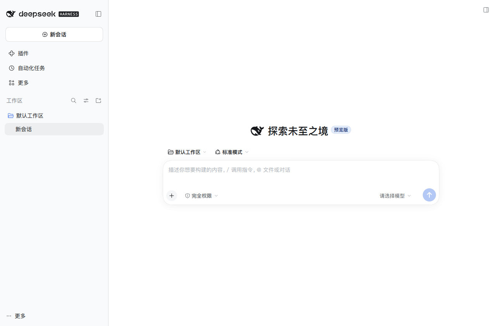
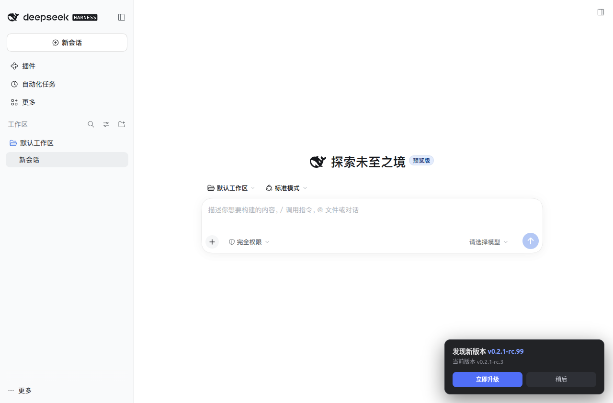

# DSH Desktop（Linux 桌面客户端）

[](https://github.com/ilovecnxx/dsh-desktop/actions/workflows/ci.yml)
[](LICENSE)
[](https://github.com/ilovecnxx/dsh-desktop)

为 **DeepSeek Harness** 在 Linux（Ubuntu/GNOME，Wayland 或 X11）上提供接近官方
Windows / macOS 客户端的体验：原生窗口、系统托盘、应用菜单，以及**点击一键自动升级**。

> 官方 `@deepseek-ai/dsh-desktop`（Electron）目前只打包 mac（arm64/x64）和 win（x64），
> 没有 Linux 产物。本项目是自建的轻量 Linux 客户端，复用官方 `dsh web` 服务与 Web UI，
> 不使用任何第三方二进制。

## 功能

- 原生 Electron 窗口加载现有 Web UI（同一 `~/.dsh` 会话、profile、插件）
- 系统托盘：打开窗口、检查更新、重启服务、开机自启、退出
- 应用菜单：检查更新（`Ctrl+U`）、更新通道（`next` / `latest`）、服务管理、开发者工具
- 启动后自动检查更新，之后每 6 小时一次；发现新版本时：
  - 页面右下角出现「发现新版本 vX · 立即升级」提示条
  - 系统通知提醒
- 点击升级后自动完成：停止服务 → 安装新版本 → 同步 profile 插件 → 重启服务 → 刷新界面
- 更新使用一次性配置的**免密升级助手**，之后升级不再询问密码
- **服务健康监控**：每 60 秒探测服务（可配置）；崩溃或无响应时自动重启，并显示「正在恢复服务…」页面
- **客户端壳自更新**：菜单「检查客户端更新…」，从更新源原子替换客户端文件后重启（自动备份可回滚）
- 服务自动重启可在托盘/应用菜单里开关
- **GPU 崩溃兼容**：GPU 进程反复崩溃时提示切换「软件渲染」（启动失败时自动切换重启），重启后生效
- **界面动效省电**：默认「自动」模式（失焦或空闲 90 秒暂停循环动画，输入即恢复），
  可设正常/仅失焦/始终暂停；实测运行态动画 CPU 66% → 8.2%
- **Linux 安装包**：支持 `npm run dist:linux` 生成 `.deb` / AppImage，Release CI 自动发布
- **系统通知**：窗口未聚焦时，会话完成/等待确认会弹系统通知，点击回到客户端（可开关）
- **更新与诊断**：可配置检查间隔与 npm 镜像源；诊断面板支持导出诊断包、清理缓存、
  备份会话、导出 Markdown、回滚客户端/dsh 运行时
- **多窗口**：`Ctrl+Shift+N` 新建窗口，每个窗口独立会话视图
- **最近会话**：应用/托盘菜单直接打开最近的会话
- **附件与下载**：拖拽/粘贴文件或图片插入真实路径；长文本粘贴自动转文本文档；下载统一目录与完成通知
- **桌面集成**：`dsh://` 协议（`dsh://new` 新建窗口），安装时注册处理程序
- **服务解耦**：可把后台服务切换为 systemd 用户服务，客户端重启/崩溃不中断会话
- **root 开发模式（实验性）**：可让后台服务以 root 运行，提供免密助手与属主修复
- **外部服务模式**：客户端可只连接指定端口的外部 dsh 服务（如 root 系统服务）
- **日志轮转**：`main.log` / `server.log` 超过 2 MiB 自动轮转为 `.1`，避免长期运行无限增长
- 应用菜单/托盘/设置提供「彻底退出（含网页服务）」；`Ctrl+Q` 只退出客户端、保留服务
- 关闭窗口行为可选：收进托盘 / 退出客户端（保留服务）/ 彻底退出；托盘菜单创建时即绑定
- **设置中心**（`Ctrl+,`）：更新通道、自动更新、自动重启、托盘、开机自启、全局快捷键、健康检查间隔
- **诊断面板**：版本/服务状态/最近日志，一键复制诊断信息或重启服务
- **全局快捷键** `Ctrl+Alt+Space`：显示/隐藏窗口（可关闭）。Wayland 下默认以 XWayland 运行以支持全局快捷键，可在设置里退回原生 Wayland
- 托盘显示服务状态；窗口位置/大小自动记忆
- 端口自动回退：3080 被非 dsh 程序占用时自动尝试后续端口
- 关闭窗口默认收进托盘；`~/.config/dsh-desktop/config.json` 可调整行为

## 界面预览

| 主界面 | 发现新版本 |
|---|---|
|  |  |

## 首次启动

从应用菜单点击 **DeepSeek Harness**（或运行 `dsh-desktop`）。客户端会先显示连接窗口，
然后校验并复用已有的 `dsh web` 服务（例如网页版入口启动的服务）；只有在明确执行
「接管」「重启服务」或升级运行时时才会停止外部服务。

窗口关闭默认收进系统托盘，后台服务继续运行。退出有两种：

- **退出（`Ctrl+Q`）**：只关闭客户端，保留后台/网页版服务
- **彻底退出（含网页服务）**：同时停止客户端托管服务、已识别外部服务与用户级
  `dsh-web-session.service`


## 目录结构

```
dsh-desktop/
├── main/
│   ├── main.js       # 应用入口：窗口、托盘、菜单、IPC、更新编排
│   ├── server.js     # dsh web 服务生命周期（启动/停止/接管/重启）
│   ├── updater.js    # npm 版本检查、免密升级、profile 插件同步
│   ├── shell-updater.js # 客户端壳自更新（检查更新源、原子替换、回滚）
│   ├── utility.js    # 设置中心 + 诊断面板窗口
│   ├── runtime-utils.js # 有界日志读取、脱敏、日志轮转、GPU 降级策略
│   ├── config.js     # 配置持久化（原子写入）
│   └── menu.js       # 应用菜单 + 托盘菜单
├── preload/
│   ├── preload.js    # 页面内更新提示条（Shadow DOM 注入）
│   └── utility.js    # 设置/诊断窗口的白名单 IPC
├── assets/           # 图标（由官方 SVG 生成）
├── scripts/
│   ├── install-app.sh       # 原子安装到用户目录（无需 root）
│   ├── launch-app.sh        # 启动器：显示协议/软件渲染/环境校验
│   ├── dsh-web             # 网页版入口（flock 单实例 + token 校验）
│   ├── configure-sandbox.sh # 复用系统 chrome-sandbox
│   ├── setup-privileged.sh  # 一次性特权配置（sudo：升级助手 + 沙箱）
│   ├── dsh-update.sh        # root 升级助手（安装到 /usr/local/sbin）
│   └── uninstall-app.sh     # 卸载客户端
├── test/                    # node --test 单元测试
├── verification/            # 启动/恢复实测记录
└── .github/workflows/ci.yml # CI：安装依赖并跑测试
```

## 安装

环境要求：Node.js ≥ 20（开发测试使用 Node 24）、npm、Ubuntu/GNOME（Wayland 或 X11）。
首次启动前需要本机已经有可用的 `@deepseek-ai/dsh`，即 `dsh --version` 能正常输出。

```bash
git clone https://github.com/ilovecnxx/dsh-desktop.git
cd dsh-desktop
npm install                    # 安装 Electron
node node_modules/electron/install.js   # 下载 Electron 二进制（123MB）

bash scripts/install-app.sh    # 用户目录安装 + 桌面图标

# 一次性特权配置（弹一次 sudo 密码）
sudo bash scripts/setup-privileged.sh \
  "$PWD/scripts" "$USER" "$HOME/.local/opt/dsh-desktop/chrome-sandbox"
```

完成后从应用菜单点击 **DeepSeek Harness** 启动，或终端运行 `dsh-desktop`。

## 升级逻辑

1. 客户端启动 8 秒后、之后每 6 小时：请求 npm registry 的 `dist-tags`
   （通道 `next` → `dist-tags.next`；通道 `latest` → `dist-tags.latest`）
2. 与本地 `dsh --version` 比较；有新版本时在页面内显示升级提示条
3. 点击升级：
   - 停止客户端管理的 `dsh web` 进程
   - `sudo -n /usr/local/sbin/dsh-update <version>`（免密，助手内校验版本号格式）
   - 若 `@deepseek-ai/dsh-subagent-codex@<version>` 已发布，则同步 profile 插件版本
     （其 peerDependencies 要求与 dsh 精确一致）
   - 用新版本重启服务，重新加载窗口
4. 失败时尽量恢复原有服务并提示错误

## 服务健康监控

- 客户端每 15 秒（`healthIntervalMs`）探测一次当前服务
- 服务进程意外退出，或连续两次探测无响应时：
  - 自动停止旧进程并重新拉起服务
  - 期间窗口显示「正在恢复 DeepSeek Harness 服务…」页面，恢复后自动刷新回原界面
  - 系统通知提示恢复结果
- 可在托盘/应用菜单「服务 → 服务异常时自动重启」关闭
- 恢复失败会停留在恢复页并提示错误，不会白屏

## 客户端自更新

客户端壳（Electron 应用本身）与 dsh 运行时分开更新：

- 菜单「DeepSeek Harness → 检查客户端更新…」，也可由 `shellAutoCheck` 自动检查
- 更新源默认为开发目录，可用环境变量 `DSH_DESKTOP_SHELL_SOURCE` 指向任意包含
  `main/`、`preload/`、`assets/`、`package.json` 的目录，例如更新后的 `git clone`
  目录（从 GitHub 安装的用户建议显式设置该变量，指向自己维护的客户端副本）
- 更新流程：停止服务 → 复制更新源到 `resources/app.staging` 并校验 → 备份旧版为
  `resources/app.backup` → 原子换入 → 重启客户端
- 只复制白名单条目，不执行更新源中的任何脚本；失败自动恢复旧版与服务
- 客户端版本记录在 `resources/app/package.json`，「关于」窗口可见

## 安全说明

- 客户端进程始终以普通用户运行；提权只发生在一个 root 拥有的固定脚本
  `/usr/local/sbin/dsh-update` 上，sudoers 规则只允许该脚本免密执行。
- 助手脚本只接受 `x.y.z` / `x.y.z-{alpha,beta,rc}.n` 形式的版本号，且只安装
  `@deepseek-ai/dsh`；安装时使用 `--ignore-scripts` 避免以 root 执行依赖安装脚本。
- 代价：任何本地用户进程都能调用该助手升级 dsh（这正是「免密一键升级」权限）。
  单用户桌面可接受；多用户共享机器不建议启用。
- Electron 使用 `chrome-sandbox` setuid 沙箱运行渲染进程。

## 回滚 / 卸载

客户端自更新会保留一份旧版备份，可手动回滚：

```bash
APP=~/.local/opt/dsh-desktop/resources
mv "$APP/app" "$APP/app.failed" && mv "$APP/app.backup" "$APP/app"
```

卸载：

```bash
bash scripts/uninstall-app.sh
sudo rm -f /usr/local/sbin/dsh-update /etc/sudoers.d/dsh-desktop-updater
```

旧版浏览器入口（桌面图标与 `dsh-start`/`dsh-stop`/`dsh-client` 脚本）已在切换到桌面客户端时删除；
如需浏览器模式，可手动运行 `dsh web` 后访问 http://127.0.0.1:3080 。

## 已知限制

- 更新时服务会重启，正在进行的对话会中断（会话记录保留，可重新打开）。
- 客户端自更新会重启整个客户端应用（同样会重启服务），会话记录保留。
- 不存在新版本时，手动检查会提示「已是最新版本」。
- Linux 托盘依赖桌面环境的状态栏支持（GNOME 需 AppIndicator 扩展，Ubuntu 默认已启用）。
- 默认使用原生 Wayland；需要全局快捷键时在设置里开启「Wayland 兼容模式（X11）」并重启。
  XWayland 在部分显卡/驱动组合上更容易触发 GPU 进程崩溃，因此默认不开启。
- 全局快捷键 `Ctrl+Alt+Space` 默认关闭，若与其他应用冲突可在设置里关闭。
- 启用「软件渲染」后画面由 CPU 合成，性能会下降，但可规避 GPU 进程反复崩溃的机器。

## 版本与优化记录

- 1.4.10：外部服务模式下自动拉起用户服务，避免启动卡 90 秒；详见 [OPTIMIZATION-1.4.10.md](OPTIMIZATION-1.4.10.md)
- 1.4.21：修复切换后客户端不重启、root 会话占用；详见 [OPTIMIZATION-1.4.21.md](OPTIMIZATION-1.4.21.md)
- 1.4.20：切换自动拉起服务、root 模式共享会话/项目、owner-sync；详见 [OPTIMIZATION-1.4.20.md](OPTIMIZATION-1.4.20.md)
- 1.4.19：修复诊断面板服务切换/root 服务启停 action 未注册；详见 [OPTIMIZATION-1.4.19.md](OPTIMIZATION-1.4.19.md)
- 1.4.18：任务面板自动收起、迁移向导、GitHub 更新检查、性能基线；详见 [OPTIMIZATION-1.4.18.md](OPTIMIZATION-1.4.18.md)
- 1.4.17：运行中状态条空闲自动隐藏、工作区闲置回收、稳定性汇总；详见 [OPTIMIZATION-1.4.17.md](OPTIMIZATION-1.4.17.md)
- 1.4.16：任务状态条残留自动取证、界面状态导出；详见 [OPTIMIZATION-1.4.16.md](OPTIMIZATION-1.4.16.md)
- 1.4.15：软件渲染 in-process GPU 稳定性修复、每日观察快照；详见 [OPTIMIZATION-1.4.15.md](OPTIMIZATION-1.4.15.md)
- 1.4.14：CI e2e 改用 stub 页面验证长文本链路（已 green）；详见 [OPTIMIZATION-1.4.14.md](OPTIMIZATION-1.4.14.md)
- 1.4.13：工作区数量上限/LRU、附件 e2e、稳定性指标与观察、CI 自动化；详见 [OPTIMIZATION-1.4.13.md](OPTIMIZATION-1.4.13.md)
- 1.4.12：最近工作区菜单、诊断工作区数量、使用手册；详见 [OPTIMIZATION-1.4.12.md](OPTIMIZATION-1.4.12.md)
- 1.4.11：不再拦截拖拽/粘贴文件，修复 dsh 原生拖拽提示层残留导致的模糊；详见 [OPTIMIZATION-1.4.11.md](OPTIMIZATION-1.4.11.md)
- 1.4.9：拖拽模糊弹层自动诊断与关闭、阻止 file:// 导航；详见 [OPTIMIZATION-1.4.9.md](OPTIMIZATION-1.4.9.md)
- 1.4.8：修复拖拽遮罩残留导致的“模糊界面”；详见 [OPTIMIZATION-1.4.8.md](OPTIMIZATION-1.4.8.md)
- 1.4.7：修复粘贴/文件夹 IPC 未注册问题，长文本转文件端到端验证；详见 [OPTIMIZATION-1.4.7.md](OPTIMIZATION-1.4.7.md)
- 1.4.6：文件夹作为独立工作区、root 测试环境完善、双轨运行；详见 [OPTIMIZATION-1.4.6.md](OPTIMIZATION-1.4.6.md)
- 1.4.5：外部服务模式断线等待/重连加固；详见 [OPTIMIZATION-1.4.5.md](OPTIMIZATION-1.4.5.md)
- 1.4.4：开发/测试服务一键切换、root 服务启停、长文本文件名优化；详见 [OPTIMIZATION-1.4.4.md](OPTIMIZATION-1.4.4.md)
- 1.4.3：外部服务模式、root 系统服务与启动修复；详见 [OPTIMIZATION-1.4.3.md](OPTIMIZATION-1.4.3.md)
- 1.4.2：拖拽/粘贴文件路径、长文本转文件、root 服务开关；详见 [OPTIMIZATION-1.4.2.md](OPTIMIZATION-1.4.2.md)
- 1.4.1：systemd 用户服务托管、桌面集成结论；详见 [OPTIMIZATION-1.4.1.md](OPTIMIZATION-1.4.1.md)
- 1.4.0：多窗口/最近会话、附件与下载、会话备份/导出、dsh:// 协议、arm64 构建；详见 [OPTIMIZATION-1.4.0.md](OPTIMIZATION-1.4.0.md)
- 1.3.2：更新体验（频率/镜像源/更新说明）、诊断包导出、清理缓存、多显示器窗口校正；详见 [OPTIMIZATION-1.3.2.md](OPTIMIZATION-1.3.2.md)
- 1.3.1：系统通知（会话完成/等待确认）；详见 [OPTIMIZATION-1.3.1.md](OPTIMIZATION-1.3.1.md)
- 1.3.0：自动节能动效（空闲暂停）、`.deb`/AppImage 打包与 Release CI；详见 [OPTIMIZATION-1.3.0.md](OPTIMIZATION-1.3.0.md)
- 1.2.6：界面动效省电（精准暂停循环动画，CPU 66%→8.2%）；详见 [OPTIMIZATION-1.2.6.md](OPTIMIZATION-1.2.6.md)
- 1.2.5：GPU 崩溃不再直接退出、启动失败自动软件渲染、服务崩溃退避重启；详见 [OPTIMIZATION-1.2.5.md](OPTIMIZATION-1.2.5.md)
- 1.2.4：修复托盘菜单绑定（顶栏点击无反应）、关闭窗口行为可选；详见 [OPTIMIZATION-1.2.4.md](OPTIMIZATION-1.2.4.md)
- 1.2.3：GPU 崩溃软件渲染回退、日志轮转、新增 3 项测试；详见 [OPTIMIZATION-1.2.3.md](OPTIMIZATION-1.2.3.md)
- 1.2.2：彻底退出（含网页服务）、共享 `~/.dsh/web.lock`、原子安装；详见 [OPTIMIZATION-1.2.2.md](OPTIMIZATION-1.2.2.md)
- 1.2.1：启动与恢复优化（复用服务、快速失败、防重入、原子配置、有界日志）；详见 [OPTIMIZATION-1.2.1.md](OPTIMIZATION-1.2.1.md)

完整版本历史见 [CHANGELOG.md](CHANGELOG.md)。测试命令：`npm test`。

## 下载安装（正式发布）

- GitHub Release：https://github.com/ilovecnxx/dsh-desktop/releases/tag/v1.4.18
- 资产：`dsh-desktop_1.4.18_amd64.deb`、`dsh-desktop_1.4.18_arm64.deb`、
  `DeepSeek.Harness-1.4.18.AppImage`、`SHA256SUMS`
- 校验：`sha256sum -c SHA256SUMS`

## 打包分发

```bash
npm run dist:linux                 # 生成 x64 dist/*.deb 与 dist/*.AppImage
npx electron-builder --linux deb --arm64   # 生成 arm64 .deb
```

详细步骤、安装方式与发布流程见 [docs/PACKAGING.md](docs/PACKAGING.md)。

## 开发与测试

```bash
npm test        # node --test，覆盖服务生命周期、配置原子写入、诊断日志脱敏等
```

## 许可证

[MIT](LICENSE) © 2026 ilovecnxx

本项目是社区自建的 Linux 客户端，与 DeepSeek 官方无隶属关系；`DeepSeek Harness`
及相关名称、图标归其各自权利人所有。

---

[](https://github.com/deepseek-ai/deepseek-harness)
